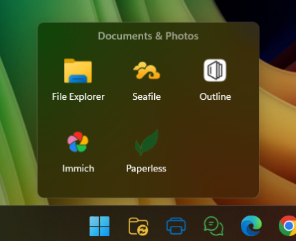
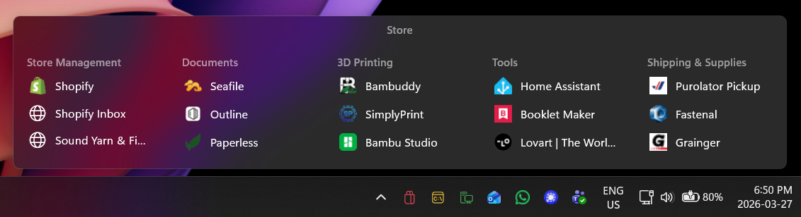
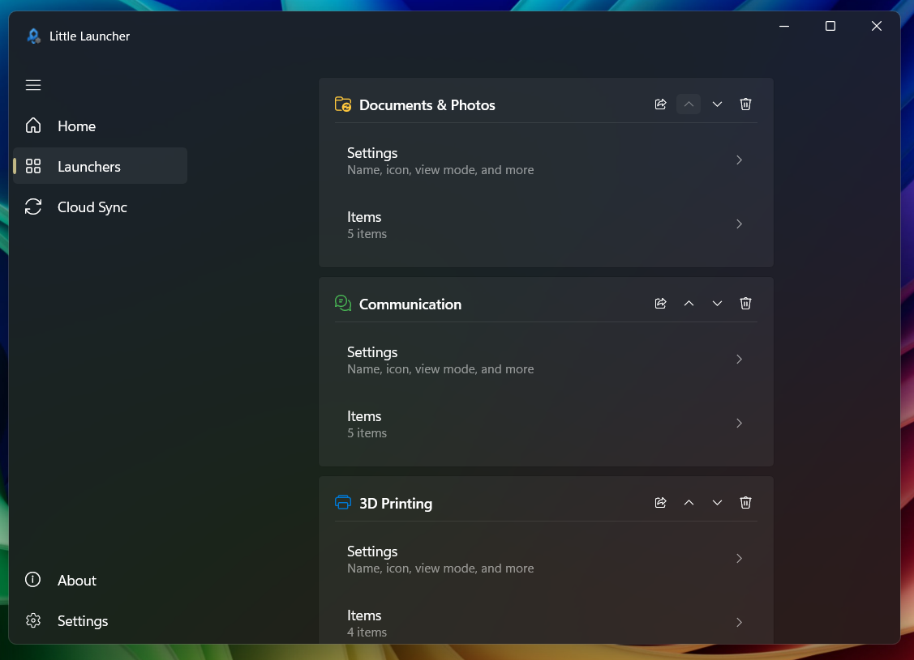
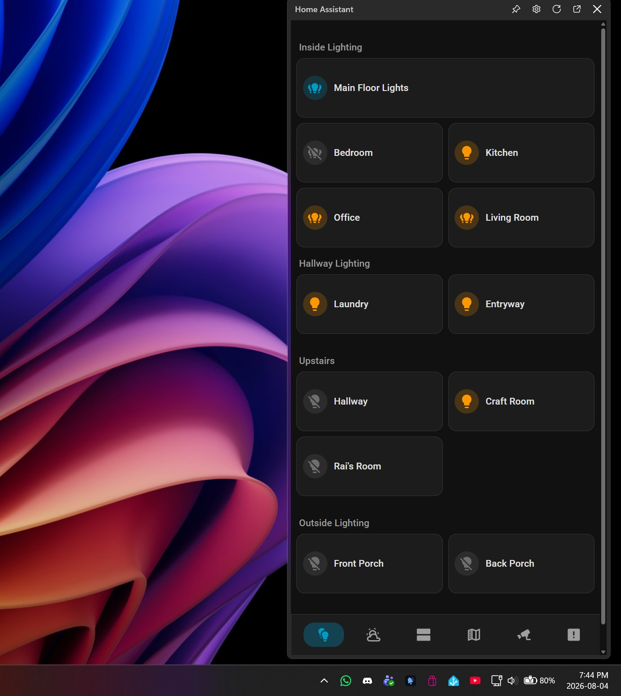
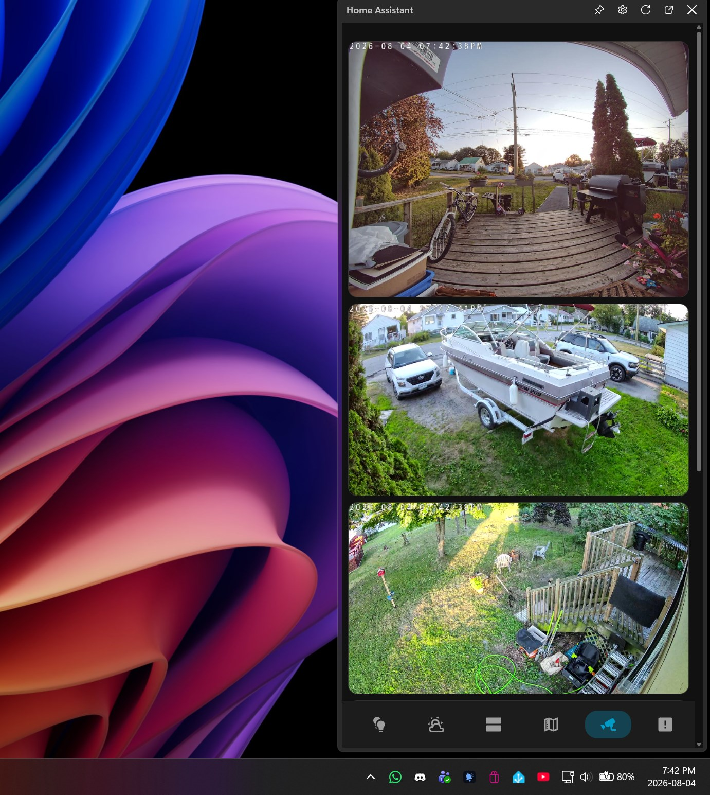
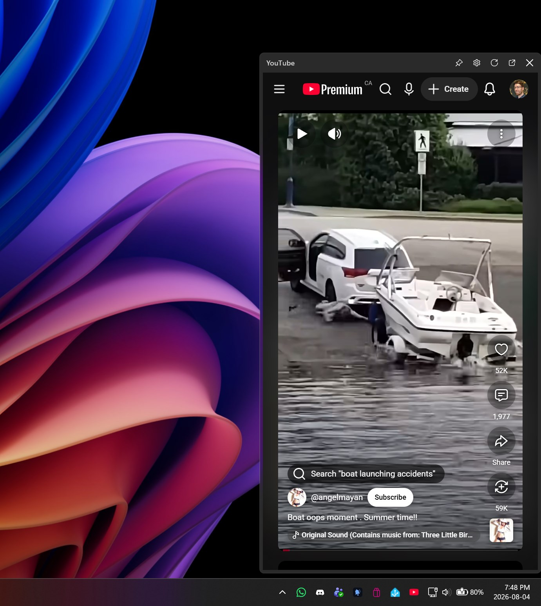

<p align="center">
  
</p>

<h1 align="center">Little Launcher</h1>

<p align="center">
  A tray launcher for apps and websites, with settings sync.
</p>

<p align="center">
  <a href="https://apps.microsoft.com/detail/9p3zzbdq6pjf">
    
  </a>
</p>

<p align="center">
  
  &nbsp;
  
  &nbsp;
  
</p>

<p align="center">
  
  &nbsp;
  
  &nbsp;
  
</p>

Little Launcher puts named launchers in your system tray. Click one and a flyout opens with your app and website shortcuts, or with a web page of its own, such as a dashboard, webmail or a chat app, one click away and signed in. It is for anyone who keeps reaching for the same handful of apps and sites and wants them a click from the taskbar on every PC they use. It is available for Windows and Linux.

## Features

- **Several launchers:** each has its own tray icon, name, icon and items, in a list, an icon grid or a compact small-icon grid, with groups and side-by-side columns.
- **Web launchers:** point a launcher at a web page and its tray icon opens that page in a flyout, with tabs, a bookmark bar, its own sign-in, real notifications and site permissions asked inside the flyout. Hidden pages are suspended so they cost nothing while you are not looking.
- **Edit in place:** drag items and groups to reorder them, drag files, folders and links in from anywhere, and right-click to move, edit or remove.
- **Pick any icon:** Fluent glyphs, emoji, bundled app icons, the selfh.st catalog or your own images.
- **Sync between devices:** keep launchers in step across PCs through OneDrive, Google Drive, WebDAV, a shared folder or your own SSH/SFTP server, and between Windows and Linux through OneDrive.
- **Share one launcher:** send someone a OneDrive link, or publish it to WebDAV, SFTP or a shared folder, and choose whether they can edit it or only receive it.
- **Bring your bookmarks:** import from Chrome, Edge, Firefox or an exported bookmarks file.
- **Fits Windows:** pin launchers to the taskbar, open web launchers from Start, and get Windows notifications with buttons and replies.

The [full feature list](docs/features.md) covers every option.

## Get it

### Windows

**Microsoft Store (recommended):** [Get Little Launcher from the Microsoft Store](https://apps.microsoft.com/detail/9p3zzbdq6pjf). It installs and updates through the Store.

**Portable copies:** versions up to 1.43.0 also came as a portable ZIP; newer versions are available only from the Store. An existing portable copy keeps working. To remove one, run `cleanup-uninstall.ps1` from its folder with the app closed (it clears settings, browser profiles and sign-ins, the startup entry and any shortcuts), then delete the folder.

**Requirements:** Windows 11 (build 22000 or later).

### Linux

Download the **x64 AppImage** from the [Releases page](https://github.com/Dynamic-Solutions-Canada/little-launcher/releases/latest), make it executable, and run it. It targets **Debian 12 / Ubuntu 24.04 LTS or newer**, with KDE as the primary desktop; GNOME needs tray support.

```bash
chmod +x LittleLauncher-VERSION-linux-x64.AppImage
./LittleLauncher-VERSION-linux-x64.AppImage
```

Replace `VERSION` with the release number, and keep the AppImage where you want it to stay. To remove it, quit the app, then delete the AppImage and the files it wrote under your home folder; [the uninstall guide](docs/installer.md#uninstall-cleanup) lists them.

Little Launcher collects no telemetry or crash reports.

## Languages

Little Launcher is available in English (United States and Canada), Spanish, French (France and Canada), German, Simplified Chinese, Brazilian Portuguese and Japanese, on both Windows and Linux. It follows the system language unless you pick one in Settings. Translations are machine-generated.

## Linux desktop support

The Linux app has native shortcut flyouts and editing, web launchers with tabs and bookmarks, profile-scoped browser extensions, selfh.st and custom icons, OneDrive personal-account sync, device-local launcher enablement and login startup. AppImage updates keep settings and browser profiles.

Shortcut launchers belong to the system that created them and show as disabled on the other; web launchers are shared. Other sync destinations and shared launchers are not available on Linux yet. Google sign-in and some passkey flows have known compatibility limits, and notification behaviour varies by site. The [Linux guide](linux/README.md) and the [UI parity review](docs/linux-ui-parity.md) describe the differences.

## Developers

- [Development guide](docs/development.md): prerequisites, the Windows build, the tech stack and the project layout.
- [Linux guide](linux/README.md): Linux development, isolated verification and AppImage builds.
- [Documentation index](docs/README.md): architecture, implementation guides and design decisions.
- [Agent instructions](AGENTS.md): conventions and the guidance map.

## License

Licensed under the [PolyForm Noncommercial License 1.0.0](LICENSE): free for any **personal and other noncommercial use**, including modifying and redistributing it. **Commercial use is not permitted.** Copyright (c) 2024-2026 Dynamic Solutions.
